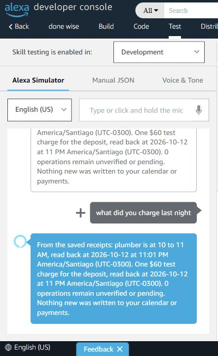

# Classic Alexa Skill Test proof — 13 October 2026

Skill `done wise`, en-US, Development, ID `amzn1.ask.skill.34982f14-6b4a-47c6-9b65-f0649d1c6a0b`.
Endpoint: `arn:aws:lambda:us-east-1:027018013541:function:donewise-alexa`.
Lambda is Python 3.12 ARM64, 512 MB, timeout 8 seconds. Its code SHA256 matches the
locally built package. Invocation permission is limited to this skill's event-source token.

The initial provisioning used ASK CLI 2.30.7, profile default, vendor M1DZO2VF4RRLZ8,
with Walter completing LWA and declining AWS profile association. AWS commands use
donewise in account 027018013541. The final remote language model exactly matches
integrations/alexa/en-US.json (RequestIntent, AskIntent and four standard intents).

## Initial provisioning, 00:06–00:27 Chile

The first manifest used an invalid category, corrected to ORGANIZERS_AND_ASSISTANTS.
Creation with the Lambda endpoint allocated failed ID
amzn1.ask.skill.fd94dae0-b0e3-4f04-aa26-694c58f62dba, then failed asynchronous trigger
validation. Creation without endpoint succeeded; its scoped trigger and endpoint
were then installed. One active skill remains. Enablement first returned an empty
403; after the full build and opening console Test it returned 204 at 00:15:38.

The [initial fixed-response evidence](alexa-simulation-2026-10-13.json) preserves
three launch/question pairs from 00:18–00:19: all SUCCESSFUL, exact RequestIntent,
fixed speech only; question execution 28/43/36 ms. Initial Lambda cold init was
774.39 ms, handler 9.01 ms, max memory 80 MB. AgentCore was absent at that time.

## Connected developer-console tests, 00:33–00:35 Chile

These UI trials were completed in the coordinated AWS Builder chat, with the same
runtime/version/receipt used below. They are preserved separately from the exact
three SMAPI pairs requested for final acceptance.

1. `open done wise` returned the fixed text: DoneWise is ready for the receipt test.
2. Set the real AgentCore ARN and removed FIXED_SPEECH. Prewarmed the runtime session
   using SHA-256 of the Alexa user ID; only the 64-character hash was forwarded.
3. Three real simulator text inputs succeeded:

| Input | Recognized intent | Receipt result |
| --- | --- | --- |
| ask done wise what did you charge last night and when is the plumber | AskIntent | Exact saved receipt |
| what did you do last night | RequestIntent | Exact saved receipt |
| what did you charge last night | RequestIntent | Exact saved receipt |

[Saved Skill I/O outputs](alexa-test-2026-10-13.json) have three distinct request IDs.
An automated comparison confirmed all three SSML bodies equal `<speak>` + the runtime's
`receipt.spoken` + `</speak>`. No timeout/fallback response occurred.

Path proven: classic Alexa Skill in Developer Console Test → Lambda → Strands/Nova Pro
on AgentCore → authenticated Lightsail MCP → existing receipts. No new calendar/payment
write is exposed to this runtime. This is **not an Alexa+ add-on** and was not tested on an Echo.
Text interaction and returned speech were verified; human microphone/audio rehearsal and
final video recording remain Walter's steps. The skill remains in Development; nothing
was submitted for certification or published.

## Final exact SMAPI pairs, 00:42–00:43 Chile

Runtime: `arn:aws:bedrock-agentcore:us-east-1:027018013541:runtime/donewise_receipts-wbsa177WJQ`,
version 1. Demo `run_b7d652a00a1e444d9ba6e54b0823107c` contains the five Sonnet 4.6
Anthropic demo turns whose registry was copied to Lightsail. The remote Strands
smoke `run_5030a0e68ed642dab6c1bd505008600b` is a distinct acceptance run.

Each trial launched `open done wise` in a new Alexa session, prewarmed Lambda and
AgentCore with the actual Alexa identity, then sent exactly
`what did you charge last night and when is the plumber`. All three recognized
RequestIntent and its exact slot, with no fallback. SHA-256 userId-derived runtime
session length was 64 hex; raw user/context envelopes were excluded from evidence.

| Chile time | Question simulation | SMAPI skill execution | Lambda/AgentCore prewarm |
| --- | --- | ---: | ---: |
| 00:42:18 | e9575aab-8d4d-43e2-96a9-e3db6a64bf6b | 1250 ms | 2829 ms |
| 00:42:42 | 9333a6de-b248-427a-9a82-1ff55c48e430 | 1124 ms | 1870 ms |
| 00:43:06 | 61270597-bafb-4fd5-8acf-a75f83e161d4 | 1853 ms | 1713 ms |

Decoded SSML equals `reference_response.receipt.spoken` exactly in all three.
[Connected evidence](alexa-connected-2026-10-13.json) includes the complete reference
receipt, operation IDs, observed_at dates, run ID, both simulation IDs per pair,
hash session ID, speech and timings. No additional provider observation is claimed.

The fresh AgentCore CLI gate used the comma-containing prompt, a new 47-character
session and four requests: 3786 ms first/new session; 2816/2808/3367 ms warm. These
include CLI overhead and satisfy the 6500 ms gate. [Forty exported spans](alexa-runtime-spans-2026-10-13.json)
cover those four traces; each has one `execute_tool receipts_recap`, no write tools.

## IAM closure and verification

At 00:37 Chile the managed policy DoneWiseDeployment20261013 was updated with
GetPolicy and RemovePermission only on donewise-alexa, retaining its expiry.
The existing inline DoneWiseRuntimeCreationTagging already matched the working
tree. IAM rotated the oldest non-default version when saving at the five-version
limit. The previously active JSON was backed up under ignored data before editing.

The failed-ID trigger AlexaSkillDevelopment and identical duplicate DoneWiseAlexaSkill
were removed. Fresh GetPolicy confirms one statement: AlexaSkillDevelopmentCurrent,
principal alexa-appkit.amazon.com, exact current skill event-source token. Lambda's
InvokeDoneWiseReceipts role policy grants only InvokeAgentRuntime on the runtime ARN
plus suffix wildcard. Environment contains AGENT_RUNTIME_ARN and ALEXA_SKILL_ID only.

Existing three Lambda boundary tests passed and are reusable with unchanged code;
no new tests or full suite in this closure. Remote model matches local exactly;
code ZIP SHA-256 remains `45273b828fddac0bcab0f1b60b4f29b1ab016231e5702ae1bdf992aa6f411bc6`.
No forced live timeout, microphone test or new calendar/payment mutation was run.

Reproduction commands and final resource IDs: [Alexa README](../../integrations/alexa/README.md).
